# Amorphix

**An AI architect that learns your taste, designs the whole space around you, and stays with the project until you move in.**

AI architect · powered by **Albo AI Research Lab**. Built at **hackCBS 9.0** by Vicky Sharma and Yashasvi Yadav.

Name the places, brands, films and music you love, add photos of rooms you like, and tell Amorphix how you live. Its own taste model reads the style behind them, and Amorphix turns it into three floor plans with honest trade-offs, a 3D walkthrough by day and night, a budget in your currency with the risk of going over, a shopping list from brands that match you, a drawings pack, and a shared project your architect, client and builder run together, right to the keys.

**Live: [amorphix-nine.vercel.app](https://amorphix-nine.vercel.app)** · **Judges' tour: [amorphix-nine.vercel.app/demo](https://amorphix-nine.vercel.app/demo)** · **Code: [github.com/yashasviyadav30/Amorphix](https://github.com/yashasviyadav30/Amorphix)**

| | |
|---|---|
| **The idea** | People can't name their style, but they know what they love. Amorphix reads taste from the things you love and designs from it, explaining every choice. |
| **The ML** | CLIP embeddings on your device, a calibrated taste engine, vector search on YugabyteDB, Gemini for language, and a Monte Carlo overrun-risk model. |
| **The product** | Interview → style → three plans → 3D → budget and risk → shopping list → drawings → review → the building site → snags → handover. |
| **Quality** | 410 unit tests across 66 files, 17 agent evals, and every flow run end to end in Chrome on the live site. |

---

## Contents

1. [For judges](#for-judges)
2. [The whole flow, end to end](#the-whole-flow-end-to-end)
3. [Agentic: the agents and how they work together](#agentic-the-agents-and-how-they-work-together)
4. [Built on YugabyteDB](#built-on-yugabytedb-the-taste-models-vector-store)
5. [The ML core](#the-ml-core)
6. [Tech stack](#tech-stack)
7. [Architecture](#architecture)
8. [Who it's for](#who-its-for)
9. [The AI: what models do, and what they never do](#the-ai-what-models-do-and-what-they-never-do)
10. [Space: the layout engine](#space-the-layout-engine)
11. [Change: the edit engine](#change-the-edit-engine)
12. [Money and time](#money-and-time)
13. [Collaboration: roles, review, the site, moving in](#collaboration-roles-review-the-site-moving-in)
14. [Data model](#data-model)
15. [Security and privacy](#security-and-privacy)
16. [Testing](#testing)
17. [Repository layout](#repository-layout)
18. [Run it](#run-it)
19. [Team](#team)

---

## For judges

**Open [amorphix-nine.vercel.app/demo](https://amorphix-nine.vercel.app/demo)**, or press **For judges** on the home page. No sign-in, nothing to install. On a phone, add it to your home screen and it runs as an app.

- **A guided tour, 13 stops in three chapters** (about three minutes). Maya's interview plays itself and the taste model reads her picks live; her style, three plans, the 3D walk, the budget, the shopping list and the drawings. Then her architect's studio, her builder's site and another client's last week before moving in. Then a Brooklyn café: its owner's taste, a change typed in plain words, and the café by night. Switch between homeowner, architect, builder and café owner at any stop.
- **Then "Try it yourself":** a fresh interview in English, Hindi or Hinglish, your own picks and photos, and a complete design of your own with every feature open.
- The tour's world is built through the app's own routes, so it is the same for every judge, and its accounts are view-only.

**Things worth trying**

| Try | Where |
|---|---|
| Find your style from photos of rooms you love | [/quiz](https://amorphix-nine.vercel.app/quiz) |
| Upload a floor plan you already have | [/start/plan](https://amorphix-nine.vercel.app/start/plan) |
| Do the interview in Hindi or Hinglish | [/start](https://amorphix-nine.vercel.app/start), switch the language at the top |
| Type a change in Hinglish: "kitchen ko thoda bada karo" | Make changes, on your own project |
| See the chance your budget goes over | Budget step, "Risk of going over" |

**Five minutes in the code, in this order**

1. `components/interview/useTaste.ts`: a name becomes a design description; the description and every photo become CLIP vectors on the device.
2. `lib/taste/yb.ts` and `app/api/taste/profile/route.ts`: the taste profile from four vector queries on YugabyteDB.
3. `lib/taste/engine.ts` and `scripts/calibrate-taste.ts`: the taste engine and its calibration.
4. `lib/budget/risk.ts`: the overrun-risk model, 4,000 simulated builds per design.
5. `lib/design/run.ts`, `lib/layout/`, `lib/three/`: the design agents, the layout engine and the 3D built from the same plan.
6. `agents/interviewer/`: the interviewer agent built with eve, its tools and its evals.

---

## The whole flow, end to end

From the first question to the keys, one record that every person on the project works from.

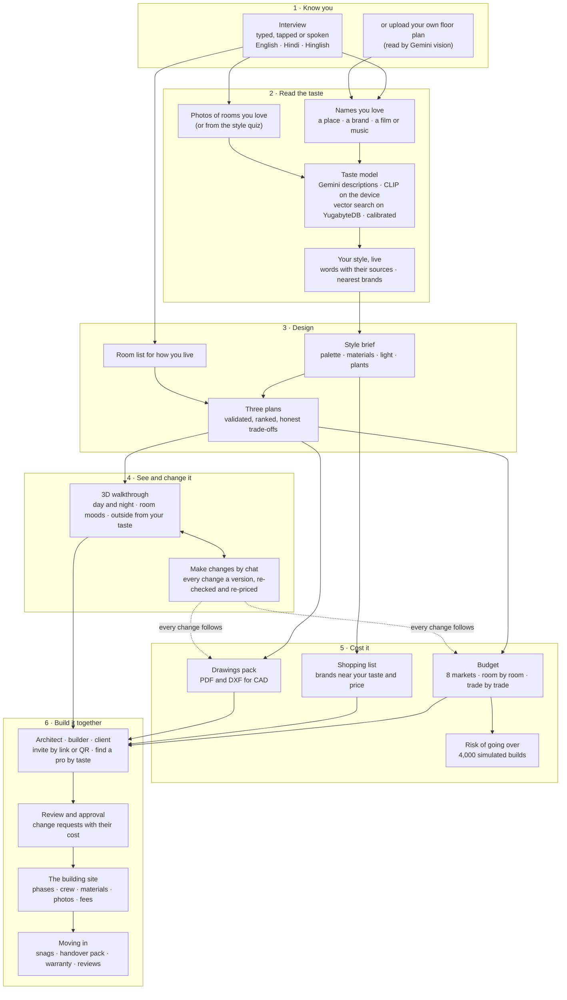

---

## Agentic: the agents and how they work together

Amorphix is a team of agents, each with one job, its own tools and a model chosen for it, around one project record. Every agent's output goes through code that checks it before anything is drawn, priced or credited. **Models propose; code verifies.**

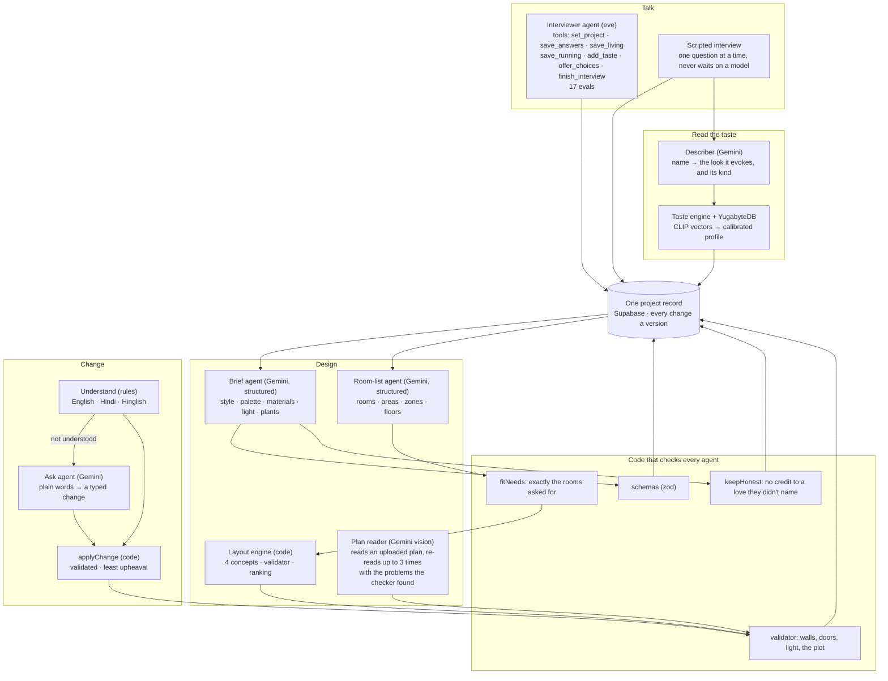

| Agent | Model | Tools and checks | Code |
|---|---|---|---|
| **Interviewer** | Gemini (eve) | 7 tools that save to the project; 17 evals, including Hindi, Hinglish and prompt injection | `agents/interviewer/` |
| **Describer** | Gemini, structured | Names capped and deduplicated, answers kept in order, the name itself as a fallback | `lib/taste/describe.ts` |
| **Taste engine** | CLIP + YugabyteDB | Calibrated standouts, layer weights, falls back to memory | `lib/taste/` |
| **Brief agent** | Gemini, structured | Schema-checked; credits only to loves the person named | `lib/design/brief.ts` |
| **Room-list agent** | Gemini, structured | `fitNeeds` fixes the rooms to the answers; a tested template if it can't be laid out | `lib/design/program.ts` |
| **Plan reader** | Gemini vision | Snapped to a layout, checked, re-read with the problems until it passes (3 tries) | `lib/plan-import/` |
| **Change agent** | rules first, Gemini second | Every change applied by the engine, validated, re-priced, saved as a version | `lib/workspace/` |

**Model routing.** `lib/models.ts` picks the model for every agent from one setting (`AMORPHIX_MODEL`), and falls through a list of Gemini models when one is out of quota, so no agent stops on a busy day.

### The ecosystem: everyone on one record

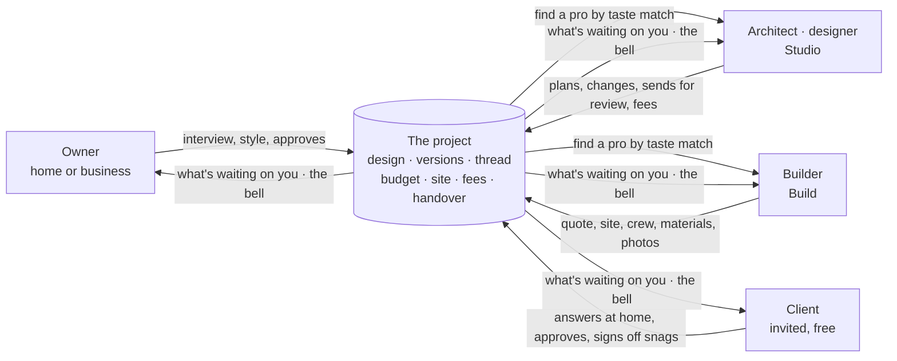

Each person sees what their role allows (one `can(role, action)` table, checked by every route): a client follows the build and the budget but never the builder's own costs.

---

## Built on YugabyteDB: the taste model's vector store

Every taste profile in Amorphix is worked out by **YugabyteDB**. The style vocabulary and the brand catalogue live in it as vectors with an HNSW index, and the brands nearest a person's taste are a nearest-neighbour query.

| Table | What it holds | Index |
|---|---|---|
| `taste_words` | 50 style words in four families (20 decor, 14 aesthetic, 12 ambience, 4 tone), each a 512-dimension CLIP vector | `ybhnsw (vector vector_cosine_ops)` |
| `taste_brands` | 30 home brands, from IKEA and Fabindia to Restoration Hardware and Good Earth, measured from the catalogue's average | `ybhnsw (vector vector_cosine_ops)` |

One request to `/api/taste/profile` runs **four queries, however many photos and names someone gives**:

```sql
-- the brands nearest the whole taste
select id, name, aesthetic, 1 - (vector <=> $taste::vector) as affinity
from taste_brands order by vector <=> $taste::vector limit $k;

-- every input against every style word, in one round trip
select s.i, 1 - (w.vector <=> s.v::vector) as sim
from unnest($inputs::text[]) with ordinality as s(v, i)
cross join taste_words w order by s.i, w.ord;
```

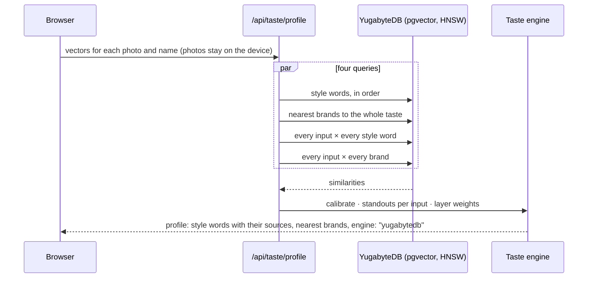

- **Measured:** the profile from YugabyteDB matches the in-memory engine to within 0.00002, in about 350 ms warm on the live site.
- **Resilient:** if the database is slow or away, the same engine runs in memory, so a taste is never lost.
- **One script to load it:** `scripts/yb-taste.ts` creates the tables and indexes and loads the vectors; safe to run again.

---

## The ML core

| Model | What it does | Where it shows | Code |
|---|---|---|---|
| **Descriptions** (Gemini) | Turns a name you love into the interior look it evokes, and says whether it is a place, a brand or culture | Your style, with its sources | `lib/taste/describe.ts` |
| **Taste embeddings** (CLIP ViT-B/32 in the browser) | Photos and descriptions into one 512-dimension space; photos never leave the device | The live taste card | `lib/taste/clip.ts`, `components/interview/useTaste.ts` |
| **Taste engine** | The style words each input stands out for, weighted by where it came from, and the nearest brands | Style, materials, room moods, the 3D | `lib/taste/engine.ts`, `lib/taste/yb.ts` |
| **Calibration** | Each word and brand counts only above its usual level | Styles that differ from person to person | `scripts/calibrate-taste.ts` |
| **Recommendations** | The brand for every piece in the 3D, near your price, with a cheaper and a dearer choice | Shopping list | `lib/shop/` |
| **Overrun-risk model** | 4,000 simulated builds per design: the chance of going over and what to keep aside | Budget | `lib/budget/risk.ts` |

### Taste: from what you love to a style

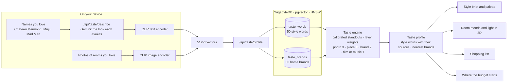

- **Every input is read the same way.** A photo, a hotel, a brand and a film all become vectors in one space; each contributes the style words it stands out for, and every word remembers which love it came from.
- **Calibrated.** On raw similarity a few broad words (japandi, contemporary) sit close to any description of a room, so almost everyone got the same style. Amorphix measures each word's and each brand's usual similarity on 42 varied loves and counts a name toward one only above that level. Checked on names left out of the calibration:

| Loves | Before | After |
|---|---|---|
| Ace Hotel New York | japandi | industrial |
| Mad Men | traditional | mid-century modern, dark wood |
| Chateau Marmont + Jonathan Adler | japandi meets contemporary | old Hollywood meets art deco, velvet |
| Blue Bottle Coffee + Norah Jones | japandi meets contemporary | Scandinavian, airy, cozy |

- **Grounded.** Every material, colour and brand in a design names the love it came from. A design never claims a source the person didn't give.

### Money: the overrun-risk model

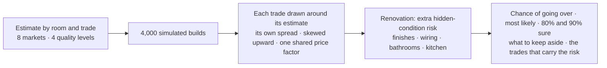

A typical renovation shows about a 61% chance of going over the planned figure and about 13% to keep aside to be 80% sure; the same work in a new building needs about 10%. The figures are planning assumptions, said so on screen, not a model trained on past projects.

---

## Tech stack

| Layer | Technology | What Amorphix uses it for |
|---|---|---|
| **Framework** | Next.js 16.4 (App Router), React 19.3, TypeScript 5 | 42 API routes, server and client pages, installable app |
| **Styling and motion** | Tailwind CSS 4, Motion 14 | The interface, page and reveal animations, light and dark |
| **3D** | three.js 0.186, React Three Fiber 9, Drei 10, postprocessing | Walkthrough, look around, day and night, the hand-drawn sketch look |
| **On-device ML** | Transformers.js 3.8 with CLIP ViT-B/32 (quantised) | Image and text embeddings in the browser |
| **Vector database** | YugabyteDB with pgvector 0.8, HNSW (`ybhnsw`) index, `postgres` driver | The taste model's style words and brands; nearest-neighbour search |
| **Language models** | Gemini through the AI SDK 7 (`@ai-sdk/google`), with a fallback list | Descriptions, the style brief, the room list, plan reading (vision), changes by chat |
| **Agents** | eve 0.75 | The interviewer agent, its tools and evals |
| **App database, auth, files** | Supabase (Postgres, Auth, Storage) | Projects, versions, the thread, sites, fees, accounts |
| **Validation** | Zod 4 | Every API body and every structured model answer |
| **Voice** | Web Speech API | Voice in and spoken replies, in three languages |
| **Hosting** | Vercel (Fluid Compute) | Deploys on every push to `main` |
| **Testing** | `node --test`, eve evals | 410 unit tests, 17 agent evals |

---

## Architecture

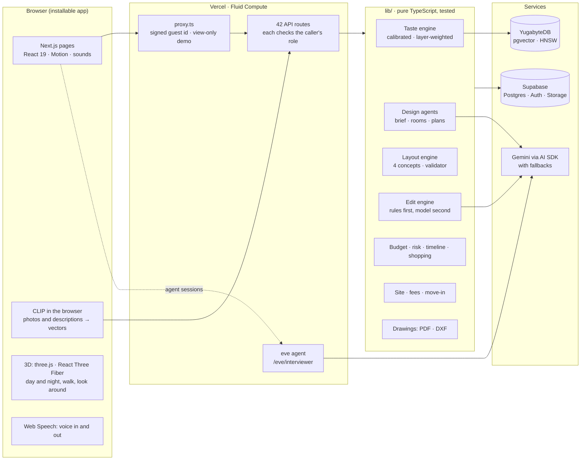

**How a design is made.** The model proposes; the engines decide what is valid, honest and fits.

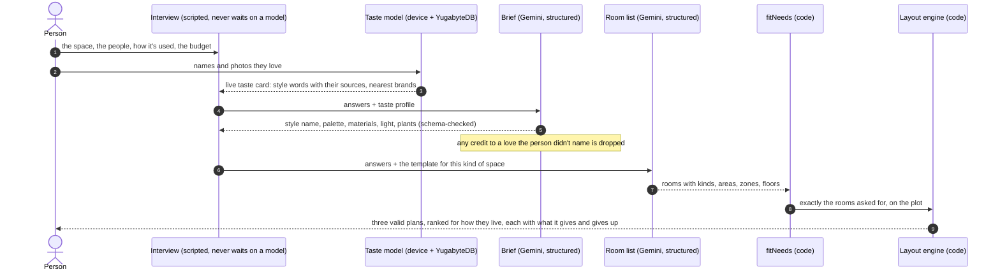

**A project's life.** Status only moves forward, and each step has a person who can take it.

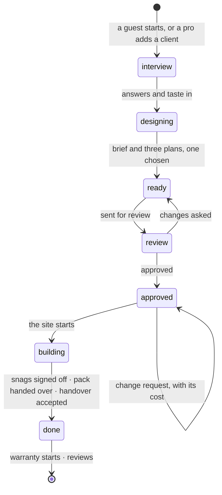

---

## Who it's for

| | What Amorphix does for them |
|---|---|
| **Homeowners** | The interview (typed, tapped or spoken, in English, Hindi or Hinglish), their style read from names and photos, three plans, the 3D, changes by chat, a budget with its risk, a shopping list, then the build and the move-in. Try it free without an account. |
| **Business owners** (café, office, shop, hotel) | Everything a home gets, plus how the place runs (service, seats, kitchen) shaping the plans, and a countdown to opening day. |
| **Architects and designers** (Studio) | A client's taste read before the first meeting, three plans on day one, changes priced at once, review and change requests on record, fees by milestone, a pipeline of every client, their branding on drawings, and owners who find them by taste match. |
| **Builders** (Build) | A site plan from the approved design, crew and wages, materials and deliveries, site money, photo updates the client follows, payments by stage, snags, handover and reviews. |
| **Clients** | Invited by their architect or builder, free: answer at home, see their style revealed, approve the design and every later change. |

---

## The AI: what models do, and what they never do

| Model does | Code does |
|---|---|
| Describes the look a name evokes, and says what kind of thing it is | Caps and deduplicates the names, keeps answers in the asked order, falls back to the name itself |
| The style brief: name, palette, materials, light, plants | Checks it against a schema and drops any credit to something the person didn't love |
| The room list for this person | Gives every room a unique id and a real floor, fixes the bedroom count, guest room and study to the answers, falls back to a tested template |
| Reads an uploaded plan (vision) | Snaps it into an editable layout and asks the person to confirm what it was unsure of |
| Understands a change it hasn't seen | Parses common changes without a model at all (English, Hindi, Hinglish) and applies every change through the engine |

**Model routing.** One place (`lib/models.ts`) picks the model for every agent; `AMORPHIX_MODEL` switches it. When a Gemini model is out of quota the call falls through a list of others, so a busy day never stops the app.

**Agentic.** The interview the app runs is a script, one question at a time and never waiting on a model. The interviewer agent built with **eve** lives in `agents/interviewer/` (instructions, 7 tools including `add_taste`, `save_living` and `finish_interview`, and 17 evals covering Hindi, Hinglish, cafés, offices, hotels and prompt injection), mounted at `/eve/interviewer`. Changes by chat turn plain words into a typed change that the edit engine applies, re-checks and re-prices.

---

## Space: the layout engine

`lib/layout/` is a deterministic floor-plan engine.

- **Four concepts an architect would offer:** central hall with living to the street, central hall with living to the garden, an open great room with a private wing, and a split plan. Each is tried with several band widths and orders.
- **A building sized to its rooms**, growing into the plot step by step, never past it.
- **A validator every plan must pass:** inside the shell, no overlaps or holes, minimum widths and areas, doors on real shared walls, the front door never into a kitchen, bath or bedroom, stairs only from circulation.
- **Ranked for how they live**, with the reasons on every card, and honest comparisons: each option names what it does best and what it gives up.
- **Bring your own plan:** upload a photo or PDF, check what was read, add what you love, and get your plan styled next to two other layouts of the same rooms.

---

## Change: the edit engine

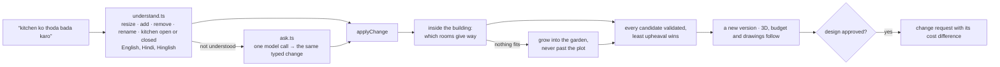

Undo walks back through saved versions. After approval, a change waits for whoever approves, with what it does to the cost.

---

## Money and time

- **Eight markets** (US, Canada, UK, Germany, Australia, UAE, Singapore, India) with researched rates for four quality levels and regional factors.
- **Room by room and trade by trade**, in local currency, for a fit-out or a new build.
- **Where the budget starts:** the quality the person told us; otherwise the price level of the brands nearest their taste.
- **The risk of going over**, from 4,000 simulated builds of the chosen design (see [the ML core](#money-the-overrun-risk-model)).
- **Shopping list:** every piece in the 3D from a brand near the person's taste and price, spread across their brands, with a cheaper and a dearer choice; a brand they named comes first. Each brand shows its logo and links to its own shop.
- **Timeline** from the size of the job, and a **greenery score** per room with one change each to raise it, shown in the 3D.

---

## Collaboration: roles, review, the site, moving in

- **Roles per project:** owner, architect, builder, client, viewer, checked by one table and by every API route.
- **Team:** invite by link or QR, or find a pro ranked by how close their past work is to your taste.
- **The thread:** one conversation per project, every approval and change request on record, and a team-only channel.
- **Fees by milestone**, billed, paid and confirmed; overdue after 14 days.
- **The site:** phases, tasks, crew and attendance, wages, materials taken off the plan, deliveries, photo updates, late alerts. The client sees progress and the budget, never the builder's own costs.
- **Moving in:** snags room by room, the handover pack, the warranty, and reviews.

---

## Data model

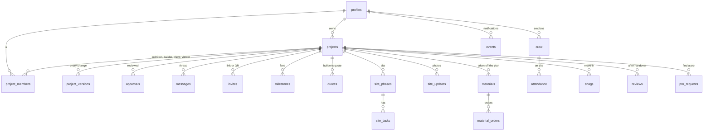

**Supabase (Postgres):** 25 tables across 15 ordered migrations in `db/migrations/`. A project keeps its design as JSON: the interview, the taste signals and profile, the brief, the room program, the plan options and the chosen one; every change is a row in `project_versions`.

**YugabyteDB:** `taste_words` and `taste_brands`, the taste model's vectors (see [above](#built-on-yugabytedb-the-taste-models-vector-store)).

---

## Security and privacy

- **Photos never leave the device.** CLIP runs in the browser; only the vectors are sent.
- **Sessions:** guests get an HMAC-signed id in an httpOnly cookie; signed-in people a signed user cookie after Supabase Auth. When a guest signs in, their projects move to the account.
- **Every route checks access** and the caller's role before any read or write; strangers get 404. The judges' demo accounts are view-only.
- **Agents** only answer requests with a valid signed cookie, and treat answers as data (an eval checks prompt injection is ignored).
- **Keys** live only in environment variables.
- **One essential cookie**, no tracking, no ads. Delete a project or the whole account at any time.

---

## Testing

| Layer | What runs | Where |
|---|---|---|
| Unit | 410 tests: the taste engine and its calibration, the risk model, the layout engine and validator, every edit, budget and markets, shopping, fees, roles, move-in, interview logic | `lib/**/*.test.ts`, `node --test` |
| Agent evals | 17 eve evals: one question at a time, all-at-once answers, Hindi, Hinglish, metric, off-topic, cafés, offices, hotels, prompt injection | `agents/interviewer/evals/` |
| Vector store | The YugabyteDB profile checked against the in-memory engine (matches to 0.00002) | `lib/taste/yb.ts` |
| End to end | In Chrome on the live site: interviews in English and Hindi, the photo quiz, plan upload, Make changes in Hinglish, every tour stop, phone width | run notes in `progress.md` |

`npm test` and `tsc --noEmit` pass before every commit.

---

## Repository layout

```
app/              pages and 42 API routes (Next.js App Router); proxy.ts signs guests
components/       screens: landing, interview, quiz, project (plans, 3D, budget, site, move-in), shell
  fx/             shared sounds, motion and effects
  three/          the 3D scene
lib/              the logic, each part with its tests beside it
  taste/          describe, CLIP, engine, YugabyteDB store, calibration, vocabulary, brand catalogue
  design/         brief, room program, plan options, comparisons
  layout/         concepts, placement, footprint, validator, walls
  workspace/      understand (rules), ask (model), edit (applyChange)
  budget/ shop/   rates for 8 markets, estimate, risk, timeline, shopping list
  project/ site/  roles, review, change requests, team, thread, fees, site, move-in
  export/         drawings pack (PDF) and DXF
agents/interviewer/  the eve agent: instructions, tools, evals
db/migrations/    15 migrations, applied in order
scripts/          the taste model's data, the demo world, checks and helpers
```

---

## Run it

```bash
npm install
cp .env.example .env.local                        # Supabase, YugabyteDB, Gemini and session keys
npm run migrate                                   # creates the tables in Supabase
node --env-file=.env.local scripts/yb-taste.ts    # loads the taste vectors into YugabyteDB
npm run dev                                       # http://localhost:3000
npm test                                          # unit tests
```

**Environment** (see `.env.example`): `GOOGLE_GENERATIVE_AI_API_KEY`, `AMORPHIX_SESSION_SECRET` (32+ random characters; signs the cookies), `SUPABASE_URL`, `SUPABASE_SERVICE_ROLE_KEY`, `NEXT_PUBLIC_SUPABASE_URL`, `NEXT_PUBLIC_SUPABASE_PUBLISHABLE_KEY`, `POSTGRES_URL_NON_POOLING` (for migrations), `YUGABYTE_URL`. `AMORPHIX_MODEL` picks the model.

**The taste model's data**

| Script | What it does |
|---|---|
| `scripts/embed-taste.ts` | Embeds the 50 style words and 30 brands with CLIP into `lib/taste/vectors.json` |
| `scripts/yb-taste.ts` | Loads those vectors into YugabyteDB with HNSW indexes |
| `scripts/calibrate-taste.ts` | Measures each word's and brand's usual level on 42 varied loves |
| `scripts/landing-reads.ts` | The real taste reads in the home page's band |
| `scripts/demo-world.ts` | Builds the judges' tour through the app (run against `AMORPHIX_DEMO_SEED=1 npm run dev`) |

---

## Team

- **Vicky Sharma**: the ML core (taste model, YugabyteDB vector store, calibration, risk model) and the product.
- **Yashasvi Yadav**: accounts and data, the deploy, testing and the pitch.

AI architect · powered by **Albo AI Research Lab**.

## Licence

MIT. See [LICENSE](LICENSE).
